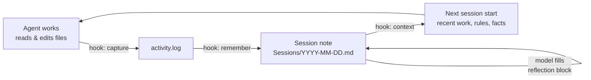

<p align="center">
  
</p>

<p align="center">
  <a href="README.md">English</a> · <a href="README.tr.md">Türkçe</a> · <a href="README.zh-CN.md">简体中文</a> · <a href="README.ja.md">日本語</a> · <b>Español</b> · <a href="README.pt-BR.md">Português</a>
</p>

<h3 align="center">Memoria persistente para tus agentes de programación</h3>

<p align="center">
  <b>Cierra la sesión, reinicia el equipo, pregunta "¿qué hicimos ayer?" y recupera tu ayer.</b>
</p>

<p align="center">
  
</p>

*Esta es una traducción de README.md; la versión en inglés es la referencia.*

<p align="center">
  <a href="https://github.com/MSelmanSonmez/Knotlog/actions/workflows/ci.yml"></a>
  <a href="https://github.com/MSelmanSonmez/Knotlog/releases"></a>
  <a href="LICENSE"></a>
  
  
</p>

<p align="center">
  <a href="#inicio-rápido">Inicio rápido</a> ·
  <a href="#cómo-funciona">Cómo funciona</a> ·
  <a href="#agentes-compatibles">Agentes compatibles</a> ·
  <a href="#preguntas-frecuentes">Preguntas frecuentes</a> ·
  <a href="#documentación">Documentación</a>
</p>

```bash
curl -fsSL https://raw.githubusercontent.com/MSelmanSonmez/Knotlog/main/install.sh | sh
```

Knotlog da a Claude Code, Codex y otros agentes de programación una memoria que sobrevive a la sesión. Guarda esa memoria como Markdown plano en una carpeta que es tuya (un *vault*), inyecta la parte relevante al inicio de cada sesión y nunca envía nada fuera de tu equipo. Es un script de shell POSIX: sin Python, sin Node, sin base de datos, sin clave de API.

> **Antes Quipu.** Knotlog es el nuevo nombre de Quipu; el antiguo comando `quipu` ya no existe. Si tienes un vault creado con el nombre anterior, ejecuta `knotlog migrate` para ver los cambios y `knotlog migrate --apply` para escribirlos; también reescribe los antiguos comandos de hook `quipu` a `knotlog`. Un bloque de puente que hayas editado a mano no se actualiza (solo se renombran sus marcadores) y recibirás una advertencia.

## La prueba de la amnesia

La prueba más corta de lo que Knotlog te aporta. Hazla tú mismo:

1. Haz trabajo real con tu agente: toma decisiones, escribe notas, cierra un tema.
2. Cierra la sesión. Reinicia el equipo.
3. Abre una sesión nueva y haz una sola pregunta: *"¿Qué hicimos ayer?"*

Sin Knotlog la respuesta es *"No tengo acceso a conversaciones anteriores."*
Con Knotlog la respuesta es tu ayer: las decisiones, sus motivos y
dónde lo dejaste, leído desde el vault y no desde la memoria del modelo.

## Inicio rápido

**macOS / Linux — una línea, sin clonar:**

```bash
curl -fsSL https://raw.githubusercontent.com/MSelmanSonmez/Knotlog/main/install.sh | sh
```

**Windows (PowerShell, desde el código fuente):**

```powershell
git clone https://github.com/MSelmanSonmez/Knotlog.git; cd Knotlog
.\install.ps1
```

**macOS / Linux / Git Bash (desde el código fuente):**

```bash
git clone https://github.com/MSelmanSonmez/Knotlog.git && cd Knotlog
./knotlog install
```

La instalación pregunta cuatro cosas (idioma, ubicación del vault, tu nombre y, opcionalmente, el nombre de un compañero y el propósito del vault), luego crea el vault, lo conecta con Claude Code y omp, y termina con un único paso siguiente: abrir la carpeta del vault y ejecutar `knotlog doctor`. Eso es todo lo que necesita un usuario nuevo.

Después lee la guía de usuario — [docs/GUIDE.es.md](docs/GUIDE.es.md) ([English](docs/GUIDE.md)) — para el ciclo diario y los comandos que se escriben a mano. ¿Aún no estás seguro de que sea para ti? [docs/WHY.es.md](docs/WHY.es.md) ([English](docs/WHY.md)) lo argumenta en una sola lectura.

## Cómo funciona



Los hooks registran qué archivos tocó el agente, `remember` convierte ese registro en una nota de sesión con fecha, y el modelo escribe el *porqué* en un bloque de reflexión dentro de ella. Al inicio de la siguiente sesión, `context` inyecta las sesiones recientes, los temas abiertos, tus reglas y tus hechos, dentro de un presupuesto fijo de bytes, para que el agente retome donde lo dejaste. Knotlog guarda el registro mecánico; el significado lo aporta el modelo que ya está en ejecución.

## Agentes compatibles

| Agente | Cómo se conecta Knotlog | Estado |
|---|---|---|
| **Claude Code** | Hooks a nivel de proyecto, configurados por `install` | Verificado en sesiones reales |
| **Codex** | `adapters/codex/hooks.json`, copiado a mano; aprueba el aviso de confianza una vez | Verificado en vivo en CLI 0.153.0 (Linux) |
| **omp** (oh-my-pi) | Hook `session_start`, configurado por `install` | Verificado una vez, en vivo |
| **Antigravity** | `knotlog setup antigravity` escribe `.agents/hooks.json` (contexto al inicio de sesión, protección de guardado al final del turno) | Cubierto por pruebas; aún sin verificar en vivo |
| **Windsurf / Devin Desktop** | `knotlog setup windsurf` escribe `.devin/hooks.json` (captura de ediciones, remember tras cada respuesta; contexto vía `AGENTS.md`) | Verificado en vivo en Linux (Devin Desktop 3.11.216); Windows sin verificar |
| **OpenCode** | `knotlog setup opencode` escribe `.opencode/plugins/knotlog.js` (captura de ediciones, remember en reposo; contexto vía `AGENTS.md`) | Verificado en vivo en Linux (OpenCode 1.19.4); Windows sin verificar |
| **Cualquier otro** (Cursor, …) | `knotlog context --bridge` escribe la memoria en `AGENTS.md` y `CLAUDE.md` | No necesita hooks |

Claude Code lee `CLAUDE.md`, la mayoría de los demás agentes leen `AGENTS.md`; Knotlog escribe la misma memoria en ambos, de modo que el trabajo hecho en un agente llega al otro. Detalles por adaptador: [docs/REFERENCE.md](docs/REFERENCE.md#claude-code).

## Por qué Knotlog

- **Cero dependencias**: solo POSIX sh + sed + awk + grep + tr + git (sin Python, Node ni jq).
- **100 % sin conexión**, **gratis**: nada sale de tu equipo, sin claves de API. El contexto entra una vez por sesión (tope de 4 KB por defecto); cada prompt solo añade una línea con la hora.
- **Multiplataforma**: Windows, macOS, Linux — verificado por CI en los tres.
- **Multilingüe**: la interfaz se distribuye en seis idiomas (English, Türkçe, Español, Português (Brasil), 日本語, 简体中文). Elige uno con `--lang <código>` (`en`, `tr`, `es`, `pt-br`, `ja`, `zh-cn`), `lang=` en la configuración o el asistente de instalación. El inglés y el turco se mantienen a mano; las demás traducciones están asistidas por máquina y las correcciones son bienvenidas.
- **Estilo de respuesta**: elige un preajuste de tono (`--tone`) y un adorno opcional, `none`, `kaomoji` o `emoji` (`--flair`), en el asistente de instalación o después con `knotlog tone` y `knotlog flair`.
- **Almacenamiento**: Markdown plano, sin base de datos — tus archivos, sin dependencia de un proveedor.
- **Control de secretos, activado por defecto**: el vault es un repositorio git con un escáner pre-commit que rechaza un commit que contenga la forma de un secreto conocido.
- **Un contrato de comportamiento, no solo notas**: `Rules.md` y `Facts.md` se inyectan al inicio de cada sesión — una corrección que escribes una vez se mantiene en la siguiente sesión en lugar de repetirse.

Por qué es gratis donde la competencia cobra por infraestructura: herramientas como claude-mem necesitan una base de datos vectorial y un worker de IA aparte porque su worker es un proceso separado sin ningún modelo dentro. Knotlog no tiene ese problema: el agente ya está en ejecución y ya está pagado, así que la capa semántica *es* el propio modelo.

## Comandos

Los que realmente vas a escribir; la tabla completa está en [docs/REFERENCE.md](docs/REFERENCE.md#commands).

| Comando | Qué hace |
|---|---|
| `knotlog doctor` | revisa la configuración: herramientas, agentes, enlaces rotos, memoria sin commit |
| `knotlog search <terms>` | busca notas (BM25, sin distinguir acentos; filtros `--tag`/`--status`) |
| `knotlog note "<text>"` | añade una línea a la reflexión de la sesión de hoy |
| `knotlog context` | muestra lo que ve el agente al inicio de la sesión |
| `knotlog tui` | explora en la terminal las notas de sesión más recientes |
| `knotlog plan <name> --proje <Project>` | abre una nota de plan dentro de un proyecto |
| `knotlog help [--<código>]` | ayuda en inglés, o en otro idioma incluido con `--<código>` (p. ej. `--tr`) |

## Una primera sesión

Una primera sesión, de principio a fin:

```
$ knotlog init
knotlog vault initialized: <vault>
layout: emoji
AGENTS.md bridge block ensured
companion.md seeded
Rules.md seeded
Facts.md seeded
next: knotlog index
Secret gate not installed: the vault is not a git repository root — run git init, then knotlog init again
$ printf '# Work note\n\nAbout Istanbul.\n' > note.md
$ knotlog index
# indexed 6 (reused 0, stale 6, dropped 0)
$ knotlog search work --paths
Rules.md
Facts.md
🔮 850-Companion/companion.md
note.md
$ knotlog context --json SessionStart
{"hookSpecificOutput":{"hookEventName":"SessionStart","additionalContext":"…"}}
$ knotlog doctor; echo $?
summary: 151 ok, 3 warn, 0 fail
0
```

Los archivos `Rules.md`, `Facts.md` y `companion.md` que se crean al inicio son
notas normales y se indexan como cualquier otra, por eso una consulta amplia los
devuelve junto a las tuyas: acota los términos o filtra con `--tag`/`--status`.
La línea del control de secretos es lo último que imprime `init`: instala
`.githooks/pre-commit` cuando el vault es la raíz de un repositorio git, y lo
indica cuando no lo es.

Pasa `--lang <código>` a `init` (p. ej. `--lang tr`) para obtener la salida en otro idioma.

## Preguntas frecuentes

<details>
<summary><b>¿Sale algo de mi equipo?</b></summary>

No. Knotlog lee y escribe archivos en tu vault y no ejecuta ningún servidor. Los únicos comandos que usan la red son el instalador y `knotlog update`, que se comunican con GitHub. Lo que Knotlog inyecta en una sesión se envía después al proveedor del modelo de tu agente, como todo lo demás de esa sesión; esa parte depende de la política de datos de tu proveedor.
</details>

<details>
<summary><b>¿Sobrescribirá mi CLAUDE.md, AGENTS.md o la configuración de Claude?</b></summary>

No. Knotlog escribe únicamente dentro de sus propios bloques con marcadores (`<!-- knotlog:start -->` … `<!-- knotlog:end -->`); todo lo que queda fuera es tuyo y nunca se toca. Si tu `.claude/settings.json` ya difiere del adaptador de Knotlog, `install` conserva tu archivo byte a byte y te indica qué debes fusionar.
</details>

<details>
<summary><b>¿Qué agentes funcionan mejor?</b></summary>

Claude Code: su adaptador está verificado en sesiones reales e `install` lo configura por ti. Codex funciona después de copiar un archivo y aprobar su aviso de confianza una vez. Cualquier otro agente puede usar el puente sin hooks, y cualquier cliente MCP puede buscar en el vault mediante `knotlog mcp` (herramientas `knotlog_search`, `knotlog_context` y `knotlog_note`). Consulta [Agentes compatibles](#agentes-compatibles).
</details>

<details>
<summary><b>¿Funciona en Windows?</b></summary>

Sí. Instala desde PowerShell con `.\install.ps1`; necesita Git for Windows y no requiere permisos de administrador. La suite de pruebas se ejecuta en Windows, macOS y Linux en CI, y se ha hecho una instalación real de extremo a extremo en Windows y Linux. macOS, por ahora, solo está verificado por CI.
</details>

<details>
<summary><b>¿Cómo lo elimino?</b></summary>

`knotlog uninstall --dry-run` muestra lo que se eliminaría, `knotlog uninstall` elimina el comando (en Windows, `.\uninstall.ps1`). Tu vault nunca se borra: son tus notas. Consulta [Uninstall](docs/REFERENCE.md#uninstall).
</details>

<details>
<summary><b>¿En qué se diferencia de una memoria basada en base de datos vectorial?</b></summary>

No hay paso de embeddings ni un segundo modelo. Knotlog hace búsqueda léxica rápida (BM25 sobre texto sin acentos) y deja el criterio al agente que ya está en el bucle. Es mejor para el significado pero más débil en recuperación exhaustiva; consulta los límites más abajo.
</details>

## Límites, con honestidad

- **La normalización pierde información**: `açık` y `acık` se funden en una sola — una decisión de compromiso deliberada.
- **"Semántico" ≠ similitud del coseno**: es el criterio del modelo, mejor para el significado pero más débil en recuperación exhaustiva.
- **Límite de contexto del índice**: cómodo hasta unos pocos miles de notas; más allá, acota primero con `search --brief`.
- **macOS está verificado por CI, aún no instalado en vivo**; si algo falla allí, es un reporte que vale la pena enviar.

La lista completa, incluido lo que cada adaptador *no* captura, está en [docs/REFERENCE.md](docs/REFERENCE.md#honest-limits).

## Documentación

- [Guía de usuario](docs/GUIDE.es.md) ([English](docs/GUIDE.md)) — el ciclo diario, las carpetas, los comandos que se escriben a mano.
- [Por qué Knotlog](docs/WHY.es.md) ([English](docs/WHY.md)) — el argumento a su favor en una sola lectura.
- [Referencia](docs/REFERENCE.md) — detalles internos de la instalación, cada comando, cada adaptador, estructura del vault, búsqueda, actualización y reversión.
- [Manual de uso](docs/USAGE.md) — configuración paso a paso escrita para que la siga un agente de programación; fijada por pruebas, de modo que no puede desviarse de los comandos reales.

## Licencia

MIT — consulta [LICENSE](LICENSE).
