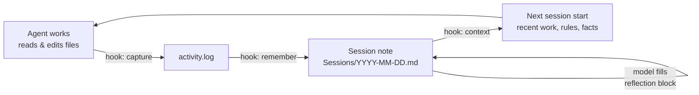

<p align="center">
  
</p>

<p align="center">
  <a href="README.md">English</a> · <a href="README.tr.md">Türkçe</a> · <a href="README.zh-CN.md">简体中文</a> · <b>日本語</b> · <a href="README.es.md">Español</a> · <a href="README.pt-BR.md">Português</a>
</p>

<h3 align="center">コーディングエージェントのための永続メモリ</h3>

<p align="center">
  <b>セッションを閉じ、マシンを再起動し、「昨日は何をした?」と尋ねる。すると、あなたの昨日が戻ってきます。</b>
</p>

<p align="center">
  
</p>

*これは README.md の日本語訳です。基準となるのは英語版です。*

<p align="center">
  <a href="https://github.com/MSelmanSonmez/Knotlog/actions/workflows/ci.yml"></a>
  <a href="https://github.com/MSelmanSonmez/Knotlog/releases"></a>
  <a href="LICENSE"></a>
  
  
</p>

<p align="center">
  <a href="#クイックスタート">クイックスタート</a> ·
  <a href="#仕組み">仕組み</a> ·
  <a href="#対応エージェント">対応エージェント</a> ·
  <a href="#よくある質問">よくある質問</a> ·
  <a href="#ドキュメント">ドキュメント</a>
</p>

```bash
curl -fsSL https://raw.githubusercontent.com/MSelmanSonmez/Knotlog/main/install.sh | sh
```

Knotlog は、Claude Code や Codex などのコーディングエージェントに、セッションより長く残るメモリを与えます。メモリはあなたが所有するフォルダ(*vault*)内のプレーンな Markdown として保存され、セッション開始のたびに関連部分が注入されます。マシンの外には何も送信しません。POSIX シェルスクリプトなので、Python、Node、データベース、API キーは不要です。

> **旧名 Quipu。** Knotlog は Quipu の新しい名前です。旧 `quipu` コマンドは廃止されました。旧名で作成した vault がある場合は、`knotlog migrate` で変更内容をプレビューし、`knotlog migrate --apply` で書き込みます。古い `quipu` のフックコマンドも `knotlog` に書き換えられます。手で編集したブリッジブロックは更新されず(マーカー名のみ置き換えられます)、警告が表示されます。

## 記憶喪失テスト

Knotlog で何が得られるかを示す、最も短い証明です。ご自身で試してください。

1. エージェントと実際に作業します。決定を下し、ノートを書き、スレッドを閉じます。
2. セッションを閉じます。マシンを再起動します。
3. 新しいセッションを開き、一つだけ質問します。*「昨日は何をした?」*

Knotlog がなければ、答えは *「以前の会話にはアクセスできません」* です。
Knotlog があれば、答えはあなたの昨日です。決定事項、その理由、作業の途中経過が、
モデルの記憶ではなく vault から読み戻されます。

## クイックスタート

**macOS / Linux — ワンライナー、チェックアウト不要:**

```bash
curl -fsSL https://raw.githubusercontent.com/MSelmanSonmez/Knotlog/main/install.sh | sh
```

**Windows (PowerShell、ソースから):**

```powershell
git clone https://github.com/MSelmanSonmez/Knotlog.git; cd Knotlog
.\install.ps1
```

**macOS / Linux / Git Bash (ソースから):**

```bash
git clone https://github.com/MSelmanSonmez/Knotlog.git && cd Knotlog
./knotlog install
```

セットアップでは、言語、vault の場所、あなたの名前、そして任意でコンパニオン名と vault の目的の四つを尋ねます。その後 vault を作成し、Claude Code と omp に接続して、次の一手を一つだけ示して終わります。vault フォルダを開き、`knotlog doctor` を実行してください。新規ユーザーに必要なのはこれだけです。

次にユーザーガイド [docs/GUIDE.ja.md](docs/GUIDE.ja.md)([English](docs/GUIDE.md) · [Türkçe](docs/GUIDE.tr.md))で、日々の流れと手で入力するコマンドを確認してください。自分に合うかまだ分からない場合は、[docs/WHY.ja.md](docs/WHY.ja.md)([English](docs/WHY.md) · [Türkçe](docs/WHY.tr.md))が一度読めば分かる形でその理由を説明しています。

## 仕組み



フックがエージェントの触れたファイルを記録し、`remember` がその記録を日付付きのセッションノートに変換します。そして、モデルがその中の振り返りブロックに *なぜそうしたか* を書き込みます。次のセッション開始時に、`context` が直近のセッション、未解決のスレッド、ルール、ファクトを固定のバイト予算内で注入するので、エージェントは前回の続きから再開できます。Knotlog が機械的な記録を担い、意味は既に動いているモデルが担います。

## 対応エージェント

| エージェント | Knotlog の接続方法 | 状態 |
|---|---|---|
| **Claude Code** | プロジェクトスコープのフック。`install` が設定 | 実セッションで検証済み |
| **Codex** | `adapters/codex/hooks.json` を手動でコピー。信頼プロンプトを一度承認 | CLI 0.153.0 (Linux) で実機検証済み |
| **omp** (oh-my-pi) | `session_start` フック。`install` が設定 | 実機で一度検証済み |
| **Antigravity** | `knotlog setup antigravity` が `.agents/hooks.json` を書き込み(セッション開始時のコンテキスト、ターン終了時の保存ガード) | テストでカバー済み。実機検証はまだ |
| **Windsurf / Devin Desktop** | `knotlog setup windsurf` が `.devin/hooks.json` を書き込み(編集の記録、応答のたびに remember。コンテキストは `AGENTS.md` 経由) | Linux で実機検証済み(Devin Desktop 3.11.216)。Windows は未検証 |
| **OpenCode** | `knotlog setup opencode` が `.opencode/plugins/knotlog.js` を書き込み(編集の記録、アイドル時に remember。コンテキストは `AGENTS.md` 経由) | Linux で実機検証済み(OpenCode 1.19.4)。Windows は未検証 |
| **その他すべて** (Cursor など) | `knotlog context --bridge` がメモリを `AGENTS.md` と `CLAUDE.md` に書き込み | フック不要 |

Claude Code は `CLAUDE.md` を、他の多くのエージェントは `AGENTS.md` を読みます。Knotlog は同じメモリを両方に書くので、一方のエージェントでの作業がもう一方にも届きます。アダプターごとの詳細: [docs/REFERENCE.md](docs/REFERENCE.md#claude-code)。

## Knotlog を選ぶ理由

- **依存ゼロ**: POSIX sh + sed + awk + grep + tr + git のみ(Python、Node、jq は不要)。
- **完全オフライン**、**無料**: マシンの外には何も出ず、API キーもトークン費用もありません。
- **クロスプラットフォーム**: Windows、macOS、Linux。三つすべてで CI 検証済み。
- **多言語**: インターフェースは六つの言語で提供されます (English, Türkçe, Español, Português (Brasil), 日本語, 简体中文)。`--lang <コード>` (`en`, `tr`, `es`, `pt-br`, `ja`, `zh-cn`)、設定の `lang=`、またはインストールウィザードで選べます。英語とトルコ語は手作業で保守し、その他の翻訳は機械支援によるもので、修正を歓迎します。
- **返信スタイル**: トーンのプリセット (`--tone`) と、任意の装飾 `none`、`kaomoji`、`emoji` (`--flair`) を、インストールウィザードで、またはあとから `knotlog tone` と `knotlog flair` で選べます。
- **ストレージ**: プレーンな Markdown でデータベースなし。ファイルはあなたのもので、ロックインもありません。
- **シークレットゲートが標準で有効**: vault は git リポジトリで、既知のシークレットの形を含むコミットを拒否する pre-commit スキャナが付いています。
- **メモ以上の「行動契約」**: `Rules.md` と `Facts.md` はセッション開始のたびに注入されます。一度書いた訂正は、繰り返さなくても次のセッションで守られます。

競合がインフラに課金するのに、なぜ無料なのか。claude-mem のようなツールは、ワーカーが内部にモデルを持たない別プロセスであるため、別のベクトルデータベースと AI ワーカーを必要とします。Knotlog にはその問題がありません。エージェントは既に動いていて料金も支払い済みなので、意味解釈の層は *モデルそのもの* です。

## コマンド

実際に入力するものだけを挙げます。完全な一覧は [docs/REFERENCE.md](docs/REFERENCE.md#commands) にあります。

| コマンド | 内容 |
|---|---|
| `knotlog doctor` | セットアップを点検: ツール、エージェント、壊れたリンク、未コミットのメモリ |
| `knotlog search <terms>` | ノートを検索(BM25、アクセント除去。`--tag`/`--status` フィルタ) |
| `knotlog note "<text>"` | 今日のセッション振り返りに一行追加 |
| `knotlog context` | セッション開始時にエージェントに見えるものを出力 |
| `knotlog tui` | 最新のセッションノートをターミナルで閲覧 |
| `knotlog plan <name> --proje <Project>` | プロジェクト内にプランノートを作成 |
| `knotlog help [--<コード>]` | 英語のヘルプ。`--<コード>` で同梱の他の言語 (例: `--tr`) |

## 最初のセッション

最初のセッションを最初から最後まで示します。

```
$ knotlog init
knotlog vault initialized: <vault>
layout: emoji
AGENTS.md bridge block ensured
companion.md seeded
Rules.md seeded
Facts.md seeded
next: knotlog index
Secret gate not installed: the vault is not a git repository root — run git init, then knotlog init again
$ printf '# Work note\n\nAbout Istanbul.\n' > note.md
$ knotlog index
# indexed 6 (reused 0, stale 6, dropped 0)
$ knotlog search work --paths
Rules.md
Facts.md
🔮 850-Companion/companion.md
note.md
$ knotlog context --json SessionStart
{"hookSpecificOutput":{"hookEventName":"SessionStart","additionalContext":"…"}}
$ knotlog doctor; echo $?
summary: 151 ok, 3 warn, 0 fail
0
```

初期投入された `Rules.md`、`Facts.md`、`companion.md` は通常のノートであり、
他のノートと同様にインデックスされます。そのため、広いクエリではあなた自身の
ノートと一緒にこれらも返されます。検索語を絞るか、`--tag`/`--status` で
絞り込んでください。シークレットゲートの行は `init` が最後に出力するものです。
vault が git リポジトリのルートであれば `.githooks/pre-commit` をインストールし、
そうでなければその旨を表示します。

他の言語で出力するには、`init` に `--lang <コード>` (例: `--lang tr`) を渡します。

## よくある質問

<details>
<summary><b>何かがマシンの外に出ますか?</b></summary>

いいえ。Knotlog は vault 内のファイルを読み書きするだけで、サーバーは動かしません。ネットワークに触れるコマンドは、GitHub と通信するインストーラーと `knotlog update` だけです。セッションに注入された内容は、そのセッションの他のすべてと同様にエージェントのモデルプロバイダーへ送られます。その部分はプロバイダーのデータポリシーに従います。
</details>

<details>
<summary><b>CLAUDE.md、AGENTS.md、Claude の設定は上書きされますか?</b></summary>

いいえ。Knotlog は自分のマーカーブロック(`<!-- knotlog:start -->` … `<!-- knotlog:end -->`)の内側にしか書き込みません。その外側はあなたのもので、触れられることはありません。`.claude/settings.json` が既に Knotlog のアダプターと異なる場合、install はあなたのファイルをバイト単位でそのまま残し、マージすべき内容を知らせます。
</details>

<details>
<summary><b>どのエージェントが最も相性がよいですか?</b></summary>

Claude Code です。そのアダプターは実セッションで検証済みで、`install` が自動で接続します。Codex は、ファイルを一つコピーして信頼プロンプトを一度承認すれば動作します。他のエージェントはフック不要のブリッジを使えますし、MCP クライアントなら `knotlog mcp`(ツール `knotlog_search`、`knotlog_context`、`knotlog_note`)経由で vault を検索できます。[対応エージェント](#対応エージェント)を参照してください。
</details>

<details>
<summary><b>Windows で動きますか?</b></summary>

はい。PowerShell から `.\install.ps1` でインストールします。Git for Windows が必要で、管理者権限は不要です。テストスイートは CI で Windows、macOS、Linux 上で実行されており、Windows と Linux では実際のエンドツーエンドのインストールも行われています。macOS はこれまでのところ CI 検証のみです。
</details>

<details>
<summary><b>どう削除しますか?</b></summary>

`knotlog uninstall --dry-run` で削除対象を確認でき、`knotlog uninstall` でコマンドを削除します(Windows では `.\uninstall.ps1`)。vault は決して削除されません。それはあなたのノートだからです。[Uninstall](docs/REFERENCE.md#uninstall) を参照してください。
</details>

<details>
<summary><b>ベクトルデータベース型のメモリとの違いは?</b></summary>

埋め込みの工程も二つ目のモデルもありません。Knotlog は高速な語彙検索(アクセント除去したテキストに対する BM25)を行い、判断は既にループ内にいるエージェントに任せます。意味の面では優れていますが、網羅的な再現率では劣ります。下記の制限を参照してください。
</details>

## 正直な制限

- **畳み込みは非可逆**: `açık` と `acık` は同一視されます。意図的なトレードオフです。
- **「意味的」≠ コサイン類似度**: モデルの判断によるもので、意味の面では優れますが、網羅的な再現率では劣ります。
- **インデックスのコンテキスト上限**: 数千ノートまでは快適です。それ以上では、まず `search --brief` で絞り込んでください。
- **macOS は CI 検証済みですが、実機へのインストールは未検証**です。問題があれば、報告する価値があります。

各アダプターが取得 *しない* ものを含む完全な一覧は、[docs/REFERENCE.md](docs/REFERENCE.md#honest-limits) にあります。

## ドキュメント

- [ユーザーガイド](docs/GUIDE.ja.md)([English](docs/GUIDE.md) · [Türkçe](docs/GUIDE.tr.md)) — 日々の流れ、フォルダ、手で入力するコマンド。
- [Why Knotlog](docs/WHY.ja.md)([English](docs/WHY.md) · [Türkçe](docs/WHY.tr.md)) — 一度読めば分かる導入理由。
- [リファレンス](docs/REFERENCE.md) — インストールの内部、全コマンド、各アダプター、vault のレイアウト、検索、アップデートとロールバック。
- [利用ランブック](docs/USAGE.md) — コーディングエージェントが従うために書かれた手順付きセットアップ。テストで固定されているため、実際のコマンド体系とずれません。

## ライセンス

MIT — [LICENSE](LICENSE) を参照してください。
