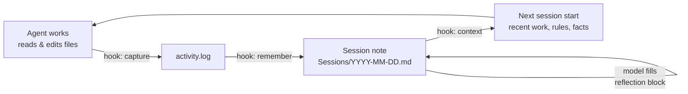

<p align="center">
  
</p>

<p align="center">
  <b>English</b> · <a href="README.tr.md">Türkçe</a> · <a href="README.zh-CN.md">简体中文</a> · <a href="README.ja.md">日本語</a> · <a href="README.es.md">Español</a> · <a href="README.pt-BR.md">Português</a>
</p>

<h3 align="center">Persistent memory for your coding agents</h3>

<p align="center">
  <b>Close the session, restart the machine, ask "what did we do yesterday?" — and get your yesterday back.</b>
</p>

<p align="center">
  
</p>

<p align="center">
  <a href="https://github.com/MSelmanSonmez/Knotlog/actions/workflows/ci.yml"></a>
  <a href="https://github.com/MSelmanSonmez/Knotlog/releases"></a>
  <a href="LICENSE"></a>
  
  
</p>

<p align="center">
  <a href="#quick-start">Quick start</a> ·
  <a href="#how-it-works">How it works</a> ·
  <a href="#supported-agents">Supported agents</a> ·
  <a href="#faq">FAQ</a> ·
  <a href="#documentation">Documentation</a>
</p>

```bash
curl -fsSL https://raw.githubusercontent.com/MSelmanSonmez/Knotlog/main/install.sh | sh
```

Knotlog gives Claude Code, Codex and other coding agents a memory that outlives the session. It keeps that memory as plain Markdown in a folder you own (a *vault*), injects the relevant part at every session start, and never sends anything off your machine. It is a POSIX shell script: no Python, no Node, no database, no API key.

> **Formerly Quipu.** Knotlog is the new name of Quipu; the old `quipu` command is gone. If you have a vault made under the old name, run `knotlog migrate` to preview the changes and `knotlog migrate --apply` to write them; it also rewrites old `quipu` hook commands to `knotlog`. A bridge block you edited by hand is not refreshed (only its markers are renamed) and you get a warning.

## The amnesia test

The shortest proof of what Knotlog buys you. Run it yourself:

1. Do some real work with your agent — make decisions, write notes, close a thread.
2. Close the session. Restart the machine.
3. Open a new session and ask one question: *"What did we do yesterday?"*

Without Knotlog the answer is *"I have no access to previous conversations."*
With Knotlog the answer is your yesterday: the decisions, their reasons, and
where you left off — read back from the vault, not from the model's memory.

## Quick start

**macOS / Linux — one line, no checkout:**

```bash
curl -fsSL https://raw.githubusercontent.com/MSelmanSonmez/Knotlog/main/install.sh | sh
```

**Windows (PowerShell, from source):**

```powershell
git clone https://github.com/MSelmanSonmez/Knotlog.git; cd Knotlog
.\install.ps1
```

**macOS / Linux / Git Bash (from source):**

```bash
git clone https://github.com/MSelmanSonmez/Knotlog.git && cd Knotlog
./knotlog install
```

Setup asks four things — language, vault location, your name, and optionally a companion name and vault purpose — then creates the vault, wires it for Claude Code and omp, and ends with one next step: open the vault folder and run `knotlog doctor`. That is all a new user needs.

Then read the user guide — [docs/GUIDE.md](docs/GUIDE.md) ([Türkçe](docs/GUIDE.tr.md) · [Español](docs/GUIDE.es.md) · [Português](docs/GUIDE.pt-BR.md) · [日本語](docs/GUIDE.ja.md) · [简体中文](docs/GUIDE.zh-CN.md)) — for the daily loop and the commands you type by hand. Not sure it is for you yet? [docs/WHY.md](docs/WHY.md) ([Türkçe](docs/WHY.tr.md) · [Español](docs/WHY.es.md) · [Português](docs/WHY.pt-BR.md) · [日本語](docs/WHY.ja.md) · [简体中文](docs/WHY.zh-CN.md)) makes the case in one read.

## How it works



Hooks record which files the agent touched, `remember` turns that ledger into a dated session note, and the model writes down *why* in a reflection block inside it. At the next session start, `context` injects the recent sessions, open threads, your rules and your facts — within a fixed byte budget — so the agent picks up where you left off. Knotlog keeps the mechanical record; the meaning comes from the model that is already running.

## Supported agents

| Agent | How Knotlog connects | Status |
|---|---|---|
| **Claude Code** | Project-scoped hooks, wired by `install` | Verified in live sessions |
| **Codex** | `adapters/codex/hooks.json`, copied by hand; approve the trust prompt once | Live-verified on CLI 0.153.0 (Linux) |
| **omp** (oh-my-pi) | `session_start` hook, wired by `install` | Verified once, live |
| **Antigravity** | `knotlog setup antigravity` writes `.agents/hooks.json` (session-start context, save guard at turn end) | Covered by tests; not yet live-verified |
| **Windsurf / Devin Desktop** | `knotlog setup windsurf` writes `.devin/hooks.json` (edit capture, remember after each response; context via `AGENTS.md`) | Live-verified on Linux (Devin Desktop 3.11.216); Windows not verified |
| **OpenCode** | `knotlog setup opencode` writes `.opencode/plugins/knotlog.js` (edit capture, remember when idle; context via `AGENTS.md`) | Live-verified on Linux (OpenCode 1.19.4); Windows not verified |
| **Anything else** (Cursor, …) | `knotlog context --bridge` writes memory into `AGENTS.md` and `CLAUDE.md` | No hooks needed |

Claude Code reads `CLAUDE.md`, most other agents read `AGENTS.md`; Knotlog writes the same memory to both, so work done in one agent reaches the other. Details per adapter: [docs/REFERENCE.md](docs/REFERENCE.md#claude-code).

## Why Knotlog

- **Zero dependencies**: POSIX sh + sed + awk + grep + tr + git only (no Python, Node, jq).
- **100% offline**, **free**: nothing leaves your machine, no API keys, zero token cost.
- **Cross-platform**: Windows, macOS, Linux — CI-verified on all three.
- **Multilingual**: the interface ships in six languages (English, Türkçe, Español, Português (Brazil), 日本語, 简体中文). Pick one with `--lang <code>` (`en`, `tr`, `es`, `pt-br`, `ja`, `zh-cn`), `lang=` in the config, or the install wizard. English and Turkish are maintained by hand; the other translations are machine-assisted, and corrections are welcome.
- **Storage**: plain Markdown, no database — your files, no lock-in.
- **Secret gate, on by default**: the vault is a git repository with a pre-commit scanner that rejects a commit carrying a known secret shape.
- **A behavior contract, not just notes**: `Rules.md` and `Facts.md` are injected at every session start — a correction you write once holds in the next session instead of being repeated.

Why free where competitors charge for infrastructure: tools like claude-mem need a separate vector database and AI worker because their worker is a separate process with no model inside. Knotlog has no such problem — the agent is already running and paid for, so the semantic layer *is* the model itself.

## Commands

The ones you will actually type; the full table is in [docs/REFERENCE.md](docs/REFERENCE.md#commands).

| Command | What it does |
|---|---|
| `knotlog doctor` | check the setup: tools, agents, broken links, uncommitted memory |
| `knotlog search <terms>` | find notes (BM25, accent-folded; `--tag`/`--status` filters) |
| `knotlog note "<text>"` | add one line to today's session reflection |
| `knotlog context` | print what the agent sees at session start |
| `knotlog tui` | browse the newest session notes in the terminal |
| `knotlog plan <name> --proje <Project>` | open a plan note inside a project |
| `knotlog help [--<code>]` | help in English, or in another shipped language with `--<code>` (e.g. `--tr`) |

## A first session

A first session, end to end:

```
$ knotlog init
knotlog vault initialized: <vault>
layout: emoji
AGENTS.md bridge block ensured
companion.md seeded
Rules.md seeded
Facts.md seeded
next: knotlog index
Secret gate not installed: the vault is not a git repository root — run git init, then knotlog init again
$ printf '# Work note\n\nAbout Istanbul.\n' > note.md
$ knotlog index
# indexed 6 (reused 0, stale 6, dropped 0)
$ knotlog search work --paths
Rules.md
Facts.md
🔮 850-Companion/companion.md
note.md
$ knotlog context --json SessionStart
{"hookSpecificOutput":{"hookEventName":"SessionStart","additionalContext":"…"}}
$ knotlog doctor; echo $?
summary: 139 ok, 3 warn, 0 fail
0
```

The seeded `Rules.md`, `Facts.md`, and `companion.md` are ordinary notes and get
indexed like any other, which is why a broad query returns them alongside your
own — narrow the terms, or filter with `--tag`/`--status`. The secret-gate line
is the last thing `init` prints: it installs `.githooks/pre-commit` when the
vault is a git repository root, and says so when it is not.

Pass `--lang <code>` to `init` (e.g. `--lang tr`) for output in another language.

## FAQ

<details>
<summary><b>Does anything leave my machine?</b></summary>

No. Knotlog reads and writes files in your vault and runs no server. The only commands that touch the network are the installer and `knotlog update`, which talk to GitHub. What Knotlog injects into a session is then sent to your agent's model provider, like everything else in that session — that part is governed by your provider's data policy.
</details>

<details>
<summary><b>Will it overwrite my CLAUDE.md, AGENTS.md or Claude settings?</b></summary>

No. Knotlog writes only inside its own marker blocks (`<!-- knotlog:start -->` … `<!-- knotlog:end -->`); everything outside them is yours and is never touched. If your `.claude/settings.json` already differs from Knotlog's adapter, install keeps your file byte for byte and tells you what to merge.
</details>

<details>
<summary><b>Which agents work best?</b></summary>

Claude Code: its adapter is verified against live sessions and `install` wires it for you. Codex works after you copy one file and approve its trust prompt once. Any other agent can use the hook-less bridge, and any MCP client can search the vault through `knotlog mcp` (tools `knotlog_search`, `knotlog_context` and `knotlog_note`). See [Supported agents](#supported-agents).
</details>

<details>
<summary><b>Does it work on Windows?</b></summary>

Yes. Install from PowerShell with `.\install.ps1`; it needs Git for Windows and no administrator rights. The test suite runs on Windows, macOS and Linux in CI, and a real end-to-end install has been done on Windows and Linux. macOS is CI-verified only so far.
</details>

<details>
<summary><b>How do I remove it?</b></summary>

`knotlog uninstall --dry-run` shows what would go, `knotlog uninstall` removes the command (on Windows, `.\uninstall.ps1`). Your vault is never deleted — those are your notes. See [Uninstall](docs/REFERENCE.md#uninstall).
</details>

<details>
<summary><b>How is this different from a vector-database memory?</b></summary>

There is no embedding step and no second model. Knotlog does fast lexical search (BM25 over accent-folded text) and leaves judgement to the agent that is already in the loop. That is better on meaning but weaker on exhaustive recall — see the limits below.
</details>

## Honest limits

- **Folding is lossy**: `açık` and `acık` collapse together — a deliberate trade-off.
- **"Semantic" ≠ cosine similarity**: model judgment, better on meaning but weaker on exhaustive recall.
- **Index context limit**: comfortable up to a few thousand notes; beyond that, narrow first with `search --brief`.
- **macOS is CI-verified, not yet installed live**; if something is off there, that is a report worth filing.

The complete list, including what each adapter does *not* capture, is in [docs/REFERENCE.md](docs/REFERENCE.md#honest-limits).

## Documentation

- [User guide](docs/GUIDE.md) ([Türkçe](docs/GUIDE.tr.md) · [Español](docs/GUIDE.es.md) · [Português](docs/GUIDE.pt-BR.md) · [日本語](docs/GUIDE.ja.md) · [简体中文](docs/GUIDE.zh-CN.md)) — the daily loop, the folders, the commands you type by hand.
- [Why Knotlog](docs/WHY.md) ([Türkçe](docs/WHY.tr.md) · [Español](docs/WHY.es.md) · [Português](docs/WHY.pt-BR.md) · [日本語](docs/WHY.ja.md) · [简体中文](docs/WHY.zh-CN.md)) — the case for it in one read.
- [Reference](docs/REFERENCE.md) — install internals, every command, each adapter, vault layout, search, update and rollback.
- [Usage runbook](docs/USAGE.md) — step-by-step setup written for a coding agent to follow; locked by tests, so it cannot drift from the real command surface.

## License

MIT — see [LICENSE](LICENSE).
