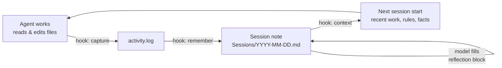

<p align="center">
  
</p>

<p align="center">
  <a href="README.md">English</a> · <a href="README.tr.md">Türkçe</a> · <a href="README.zh-CN.md">简体中文</a> · <a href="README.ja.md">日本語</a> · <a href="README.es.md">Español</a> · <b>Português</b>
</p>

<h3 align="center">Memória persistente para os seus agentes de código</h3>

<p align="center">
  <b>Feche a sessão, reinicie a máquina, pergunte "o que fizemos ontem?" — e receba o seu ontem de volta.</b>
</p>

<p align="center"><i>Esta é uma tradução do README.md; a versão em inglês é a referência.</i></p>

<p align="center">
  <a href="https://github.com/MSelmanSonmez/Knotlog/actions/workflows/ci.yml"></a>
  <a href="https://github.com/MSelmanSonmez/Knotlog/releases"></a>
  <a href="LICENSE"></a>
  
  
</p>

<p align="center">
  <a href="#início-rápido">Início rápido</a> ·
  <a href="#como-funciona">Como funciona</a> ·
  <a href="#agentes-compatíveis">Agentes compatíveis</a> ·
  <a href="#faq">FAQ</a> ·
  <a href="#documentação">Documentação</a>
</p>

```bash
curl -fsSL https://raw.githubusercontent.com/MSelmanSonmez/Knotlog/main/install.sh | sh
```

O Knotlog dá ao Claude Code, ao Codex e a outros agentes de código uma memória que sobrevive à sessão. Ele guarda essa memória como Markdown simples em uma pasta que é sua (um *vault*), injeta a parte relevante no início de cada sessão e nunca envia nada para fora da sua máquina. É um script POSIX shell: sem Python, sem Node, sem banco de dados, sem chave de API.

> **Antigo Quipu.** Knotlog é o novo nome do Quipu; o antigo comando `quipu` foi removido. Se você tem um vault criado com o nome antigo, execute `knotlog migrate` para ver as mudanças e `knotlog migrate --apply` para gravá-las; ele também reescreve os antigos comandos de hook `quipu` para `knotlog`. Um bloco de ponte que você editou à mão não é atualizado (apenas seus marcadores são renomeados) e você recebe um aviso.

## O teste da amnésia

A prova mais curta do que o Knotlog entrega. Faça você mesmo:

1. Faça um trabalho real com o seu agente — tome decisões, escreva notas, feche uma pendência.
2. Feche a sessão. Reinicie a máquina.
3. Abra uma nova sessão e faça uma única pergunta: *"O que fizemos ontem?"*

Sem o Knotlog, a resposta é *"Não tenho acesso a conversas anteriores."*
Com o Knotlog, a resposta é o seu ontem: as decisões, os motivos delas e
onde você parou — lido de volta do vault, não da memória do modelo.

## Início rápido

**macOS / Linux — uma linha, sem clonar nada:**

```bash
curl -fsSL https://raw.githubusercontent.com/MSelmanSonmez/Knotlog/main/install.sh | sh
```

**Windows (PowerShell, a partir do código-fonte):**

```powershell
git clone https://github.com/MSelmanSonmez/Knotlog.git; cd Knotlog
.\install.ps1
```

**macOS / Linux / Git Bash (a partir do código-fonte):**

```bash
git clone https://github.com/MSelmanSonmez/Knotlog.git && cd Knotlog
./knotlog install
```

A configuração pergunta quatro coisas — idioma, local do vault, seu nome e, opcionalmente, o nome de um companheiro e a finalidade do vault — depois cria o vault, conecta-o ao Claude Code e ao omp e termina com um único próximo passo: abrir a pasta do vault e executar `knotlog doctor`. É tudo o que um novo usuário precisa.

Depois, leia o guia do usuário — [docs/GUIDE.md](docs/GUIDE.md) ([Türkçe](docs/GUIDE.tr.md)) — para conhecer o ciclo diário e os comandos que você digita à mão. Ainda não tem certeza se é para você? [docs/WHY.md](docs/WHY.md) ([Türkçe](docs/WHY.tr.md)) defende a ideia em uma só leitura.

## Como funciona



Os hooks registram quais arquivos o agente tocou, o `remember` transforma esse registro em uma nota de sessão datada, e o modelo escreve o *porquê* em um bloco de reflexão dentro dela. No início da sessão seguinte, o `context` injeta as sessões recentes, as pendências em aberto, suas regras e seus fatos — dentro de um orçamento fixo de bytes — para que o agente retome de onde você parou. O Knotlog guarda o registro mecânico; o significado vem do modelo que já está em execução.

## Agentes compatíveis

| Agente | Como o Knotlog se conecta | Status |
|---|---|---|
| **Claude Code** | Hooks no escopo do projeto, configurados pelo `install` | Verificado em sessões reais |
| **Codex** | `adapters/codex/hooks.json`, copiado à mão; aprove o prompt de confiança uma vez | Verificado ao vivo na CLI 0.153.0 (Linux) |
| **omp** (oh-my-pi) | Hook `session_start`, configurado pelo `install` | Verificado uma vez, ao vivo |
| **Antigravity** | `knotlog setup antigravity` grava `.agents/hooks.json` (contexto no início da sessão, proteção de salvamento ao fim do turno) | Coberto por testes; ainda não verificado ao vivo |
| **Windsurf / Devin Desktop** | `knotlog setup windsurf` grava `.devin/hooks.json` (captura de edições, remember após cada resposta; contexto via `AGENTS.md`) | Verificado ao vivo no Linux (Devin Desktop 3.11.216); Windows não verificado |
| **OpenCode** | `knotlog setup opencode` grava `.opencode/plugins/knotlog.js` (captura de edições, remember em repouso; contexto via `AGENTS.md`) | Verificado ao vivo no Linux (OpenCode 1.19.4); Windows não verificado |
| **Qualquer outro** (Cursor, …) | `knotlog context --bridge` grava a memória em `AGENTS.md` e `CLAUDE.md` | Sem necessidade de hooks |

O Claude Code lê o `CLAUDE.md`, a maioria dos outros agentes lê o `AGENTS.md`; o Knotlog grava a mesma memória nos dois, então o trabalho feito em um agente chega ao outro. Detalhes por adaptador: [docs/REFERENCE.md](docs/REFERENCE.md#claude-code).

## Por que o Knotlog

- **Zero dependências**: apenas POSIX sh + sed + awk + grep + tr + git (sem Python, Node ou jq).
- **100% offline** e **gratuito**: nada sai da sua máquina, sem chaves de API, custo zero de tokens.
- **Multiplataforma**: Windows, macOS, Linux — verificado por CI nos três.
- **Multilíngue**: turco e inglês de primeira classe; outros idiomas via perfis.
- **Armazenamento**: Markdown simples, sem banco de dados — seus arquivos, sem dependência de fornecedor.
- **Barreira de segredos, ativada por padrão**: o vault é um repositório git com um scanner de pre-commit que rejeita um commit que carregue um formato conhecido de segredo.
- **Um contrato de comportamento, não apenas notas**: `Rules.md` e `Facts.md` são injetados no início de cada sessão — uma correção que você escreve uma vez vale na sessão seguinte, em vez de ser repetida.

Por que é gratuito onde os concorrentes cobram por infraestrutura: ferramentas como o claude-mem precisam de um banco de dados vetorial e de um worker de IA separados, porque o worker delas é um processo à parte, sem modelo dentro. O Knotlog não tem esse problema — o agente já está em execução e já foi pago, então a camada semântica *é* o próprio modelo.

## Comandos

Os que você realmente vai digitar; a tabela completa está em [docs/REFERENCE.md](docs/REFERENCE.md#commands).

| Comando | O que faz |
|---|---|
| `knotlog doctor` | verifica a configuração: ferramentas, agentes, links quebrados, memória sem commit |
| `knotlog search <terms>` | encontra notas (BM25, sem distinção de acentos; filtros `--tag`/`--status`) |
| `knotlog note "<text>"` | adiciona uma linha à reflexão da sessão de hoje |
| `knotlog context` | exibe o que o agente vê no início da sessão |
| `knotlog tui` | navega pelas notas de sessão mais recentes no terminal |
| `knotlog plan <name> --proje <Project>` | abre uma nota de plano dentro de um projeto |
| `knotlog help [--tr]` | ajuda em inglês, ou em turco com `--tr` |

## Uma primeira sessão

Uma primeira sessão, de ponta a ponta:

```
$ knotlog init
knotlog vault initialized: <vault>
layout: emoji
AGENTS.md bridge block ensured
companion.md seeded
Rules.md seeded
Facts.md seeded
next: knotlog index
Secret gate not installed: the vault is not a git repository root — run git init, then knotlog init again
$ printf '# Work note\n\nAbout Istanbul.\n' > note.md
$ knotlog index
# indexed 6 (reused 0, stale 6, dropped 0)
$ knotlog search work --paths
Rules.md
Facts.md
🔮 850-Companion/companion.md
note.md
$ knotlog context --json SessionStart
{"hookSpecificOutput":{"hookEventName":"SessionStart","additionalContext":"…"}}
$ knotlog doctor; echo $?
summary: 71 ok, 3 warn, 0 fail
0
```

Os arquivos `Rules.md`, `Facts.md` e `companion.md` criados na inicialização são
notas comuns e são indexados como qualquer outra, e é por isso que uma consulta
ampla os devolve junto com as suas — restrinja os termos ou filtre com
`--tag`/`--status`. A linha da barreira de segredos é a última coisa que o
`init` exibe: ele instala `.githooks/pre-commit` quando o vault é a raiz de um
repositório git e avisa quando não é.

Passe `--lang tr` ao `init` para obter a saída em turco.

## FAQ

<details>
<summary><b>Alguma coisa sai da minha máquina?</b></summary>

Não. O Knotlog lê e grava arquivos no seu vault e não executa nenhum servidor. Os únicos comandos que usam a rede são o instalador e o `knotlog update`, que falam com o GitHub. O que o Knotlog injeta em uma sessão é então enviado ao provedor de modelo do seu agente, como todo o resto daquela sessão — essa parte é regida pela política de dados do seu provedor.
</details>

<details>
<summary><b>Ele vai sobrescrever meu CLAUDE.md, AGENTS.md ou as configurações do Claude?</b></summary>

Não. O Knotlog grava apenas dentro dos seus próprios blocos de marcação (`<!-- knotlog:start -->` … `<!-- knotlog:end -->`); tudo fora deles é seu e nunca é tocado. Se o seu `.claude/settings.json` já difere do adaptador do Knotlog, o install mantém o seu arquivo byte a byte e diz o que você precisa mesclar.
</details>

<details>
<summary><b>Quais agentes funcionam melhor?</b></summary>

Claude Code: o adaptador dele é verificado em sessões reais e o `install` o configura para você. O Codex funciona depois que você copia um arquivo e aprova o prompt de confiança uma vez. Qualquer outro agente pode usar a ponte sem hooks, e qualquer cliente MCP pode pesquisar o vault por meio do `knotlog mcp` (ferramentas `knotlog_search`, `knotlog_context` e `knotlog_note`). Veja [Agentes compatíveis](#agentes-compatíveis).
</details>

<details>
<summary><b>Funciona no Windows?</b></summary>

Sim. Instale pelo PowerShell com `.\install.ps1`; é preciso ter o Git for Windows e não são necessários direitos de administrador. A suíte de testes é executada no Windows, no macOS e no Linux no CI, e uma instalação real de ponta a ponta já foi feita no Windows e no Linux. O macOS, por enquanto, é verificado apenas pelo CI.
</details>

<details>
<summary><b>Como eu o removo?</b></summary>

`knotlog uninstall --dry-run` mostra o que seria removido, `knotlog uninstall` remove o comando (no Windows, `.\uninstall.ps1`). Seu vault nunca é apagado — essas são as suas notas. Veja [Uninstall](docs/REFERENCE.md#uninstall).
</details>

<details>
<summary><b>Em que isso difere de uma memória com banco de dados vetorial?</b></summary>

Não há etapa de embedding nem um segundo modelo. O Knotlog faz busca lexical rápida (BM25 sobre texto sem distinção de acentos) e deixa o julgamento para o agente que já está no circuito. Isso é melhor para significado, mas mais fraco para recuperação exaustiva — veja os limites abaixo.
</details>

## Limites honestos

- **A normalização perde informação**: `açık` e `acık` colapsam juntos — uma troca deliberada.
- **"Semântico" ≠ similaridade de cosseno**: é julgamento do modelo, melhor para significado, mas mais fraco para recuperação exaustiva.
- **Limite de contexto do índice**: confortável até alguns milhares de notas; além disso, restrinja primeiro com `search --brief`.
- **O macOS é verificado pelo CI, mas ainda não foi instalado ao vivo**; se algo estiver errado por lá, vale a pena abrir um relato.

A lista completa, incluindo o que cada adaptador *não* captura, está em [docs/REFERENCE.md](docs/REFERENCE.md#honest-limits).

## Documentação

- [Guia do usuário](docs/GUIDE.md) ([Türkçe](docs/GUIDE.tr.md)) — o ciclo diário, as pastas, os comandos que você digita à mão.
- [Por que o Knotlog](docs/WHY.md) ([Türkçe](docs/WHY.tr.md)) — o argumento a favor em uma só leitura.
- [Referência](docs/REFERENCE.md) — detalhes internos da instalação, cada comando, cada adaptador, layout do vault, busca, atualização e rollback.
- [Runbook de uso](docs/USAGE.md) — configuração passo a passo escrita para um agente de código seguir; travada por testes, então não pode se desviar da superfície real de comandos.

## Licença

MIT — veja [LICENSE](LICENSE).
