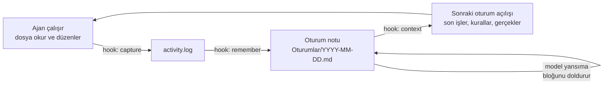

<p align="center">
  
</p>

<p align="center">
  <a href="README.md">English</a> · <b>Türkçe</b> · <a href="README.zh-CN.md">简体中文</a> · <a href="README.ja.md">日本語</a> · <a href="README.es.md">Español</a> · <a href="README.pt-BR.md">Português</a>
</p>

<h3 align="center">Kodlama ajanların için kalıcı hafıza</h3>

<p align="center">
  <b>Oturumu kapat, bilgisayarı yeniden başlat, "dün ne yaptık?" diye sor — dünün geri gelsin.</b>
</p>

<p align="center">
  
</p>

<p align="center">
  <a href="https://github.com/MSelmanSonmez/Knotlog/actions/workflows/ci.yml"></a>
  <a href="https://github.com/MSelmanSonmez/Knotlog/releases"></a>
  <a href="LICENSE"></a>
  
  
  <!-- badge counts are re-measured at the release commit: tests = `sh tests/run.sh` -> "# pass N"; scripts = `git ls-files | grep -cE '^(knotlog|lib/.*\.awk|fold/.*\.sed)$'`; LongMemEval-S = `tests/bench/longmemeval.sh` -->
  
  
  
  
</p>

<p align="center"><sub>Betik sayısı, dağıtılan <code>knotlog</code> giriş betiğini ve <code>lib/*.awk</code> ile <code>fold/*.sed</code> dosyalarını sayar.</sub></p>

<p align="center">
  <a href="#hızlı-başlangıç">Hızlı başlangıç</a> ·
  <a href="#nasıl-çalışır">Nasıl çalışır</a> ·
  <a href="#desteklenen-ajanlar">Desteklenen ajanlar</a> ·
  <a href="#sss">SSS</a> ·
  <a href="#belgeler">Belgeler</a>
</p>

```bash
curl -fsSL https://raw.githubusercontent.com/MSelmanSonmez/Knotlog/main/install.sh | sh
```

Knotlog, Claude Code, Codex ve diğer kodlama ajanlarına oturum kapandığında silinmeyen bir hafıza verir. Bu hafızayı senin olan bir klasörde (*kasa*) düz Markdown olarak tutar, her oturum açılışında gerekli kısmını ajanın bağlamına basar ve makinenden dışarı hiçbir şey göndermez. Kendisi bir POSIX kabuk betiği: Python yok, Node yok, veritabanı yok, API anahtarı yok.

> **Eski adı Quipu.** Knotlog, Quipu'nun yeni adıdır; eski `quipu` komutu kaldırıldı. Eski adla oluşturulmuş bir kasan varsa değişiklikleri görmek için `knotlog migrate`, yazmak için `knotlog migrate --apply` çalıştır; bu komut eski `quipu` hook komutlarını da `knotlog` olarak yeniden yazar. Elle düzenlediğin bir köprü bloğu yenilenmez (yalnız işaretleri çevrilir) ve uyarı alırsın.

## Amnezi testi

Knotlog'un sana ne kazandırdığının en kısa kanıtı. Kendin dene:

1. Ajanınla gerçek bir iş yap — karar ver, not yaz, bir konuyu kapat.
2. Oturumu kapat. Bilgisayarı yeniden başlat.
3. Yeni bir oturum aç ve tek bir soru sor: *"Dün ne yaptık?"*

Knotlog yokken cevap *"Önceki konuşmalara erişimim yok."* olur.
Knotlog varken cevap senin dünündür: kararlar, gerekçeleri ve nerede
kaldığın — modelin hafızasından değil, kasadan okunarak.

## Hızlı başlangıç

**macOS / Linux — tek satır, depoyu indirmeden:**

```bash
curl -fsSL https://raw.githubusercontent.com/MSelmanSonmez/Knotlog/main/install.sh | sh
```

**Windows (PowerShell, kaynaktan):**

```powershell
git clone https://github.com/MSelmanSonmez/Knotlog.git; cd Knotlog
.\install.ps1
```

**macOS / Linux / Git Bash (kaynaktan):**

```bash
git clone https://github.com/MSelmanSonmez/Knotlog.git && cd Knotlog
./knotlog install
```

Kurulum dört şey sorar — dil, kasanın yeri, adın ve istersen asistanının adı ile kasanın amacı — sonra kasayı oluşturur, Claude Code ve omp için bağlar ve tek bir sonraki adımla biter: kasa klasörünü aç ve `knotlog doctor` çalıştır. Yeni başlayan biri için bu kadarı yeter.

Ardından kullanım kılavuzunu oku — [docs/GUIDE.tr.md](docs/GUIDE.tr.md) ([English](docs/GUIDE.md) · [Español](docs/GUIDE.es.md) · [Português](docs/GUIDE.pt-BR.md) · [日本語](docs/GUIDE.ja.md) · [简体中文](docs/GUIDE.zh-CN.md)) — günlük döngüyü ve elle yazdığın komutları anlatır. Sana göre olup olmadığından emin değil misin? [docs/WHY.tr.md](docs/WHY.tr.md) ([English](docs/WHY.md) · [Español](docs/WHY.es.md) · [Português](docs/WHY.pt-BR.md) · [日本語](docs/WHY.ja.md) · [简体中文](docs/WHY.zh-CN.md)) tek okumada derdini anlatır.

## Mevcut bir kod deposunda kullanım

Hook'lar kasanın `.claude/settings.json` dosyasındadır; bu yüzden yalnız ajan kasa klasöründe açılınca çalışırlar. Başka bir depoda çalışırken aynı hafızayı korumak için kasayı yerinde bırak ve depoyu ona yönlendir: [`adapters/claude-code.json`](adapters/claude-code.json) içindeki `hooks` bloğunu deponun `.claude/settings.json` dosyasına (ya da her proje için `~/.claude/settings.json`'a) kopyala ve kasanın yolunu ekle:

```json
{ "env": { "KNOTLOG_VAULT": "/path/to/your/vault" } }
```

Bundan sonra her hook o kasayı okur ve yazar; depoda düzenlediğin dosyalar son etkinlikte tam yollarıyla görünür. Bunun yerine depo içinde `knotlog init` çalıştırırsan deponun kendisi klasörleriyle birlikte bir kasaya dönüşür.

## Nasıl çalışır



Hook'lar ajanın hangi dosyalara dokunduğunu kaydeder, `remember` bu kaydı tarihli bir oturum notuna çevirir, model de notun içindeki yansıma bloğuna işin *neden*ini yazar. Bir sonraki oturum açıldığında `context` son oturumları, açık konuları, kurallarını ve gerçeklerini sabit bir bayt bütçesi içinde bağlama basar; ajan kaldığın yerden devam eder. Knotlog mekanik kaydı tutar, anlamı zaten çalışmakta olan model verir.

## Desteklenen ajanlar

| Ajan | Knotlog nasıl bağlanır | Durum |
|---|---|---|
| **Claude Code** | Kasaya özel hook'lar, `install` kurar | Canlı oturumlarda doğrulandı |
| **Codex** | `adapters/codex/hooks.json` elle kopyalanır; güven istemi bir kez onaylanır | CLI 0.153.0'da canlı doğrulandı (Linux) |
| **omp** (oh-my-pi) | `session_start` hook'u, `install` kurar | Bir kez canlı doğrulandı |
| **Antigravity** | `knotlog setup antigravity` `.agents/hooks.json` yazar (oturum açılışında bağlam, tur sonunda kayıt bekçisi) | Testlerle kapsandı; henüz canlı doğrulanmadı |
| **Windsurf / Devin Desktop** | `knotlog setup windsurf` `.devin/hooks.json` yazar (düzenleme kaydı, her yanıttan sonra remember; bağlam `AGENTS.md` ile) | Linux'ta canlı doğrulandı (Devin Desktop 3.11.216); Windows doğrulanmadı |
| **OpenCode** | `knotlog setup opencode` `.opencode/plugins/knotlog.js` yazar (düzenleme kaydı, boştayken remember; bağlam `AGENTS.md` ile) | Linux'ta canlı doğrulandı (OpenCode 1.19.4); Windows doğrulanmadı |
| **Diğerleri** (Cursor, …) | `knotlog context --bridge` hafızayı `AGENTS.md` ve `CLAUDE.md`'ye yazar | Hook gerekmez |

Claude Code `CLAUDE.md`'yi, diğer ajanların çoğu `AGENTS.md`'yi okur; Knotlog ikisine de aynı hafızayı yazar, böylece bir ajanda yapılan iş diğerine ulaşır. Adaptör ayrıntıları: [docs/REFERENCE.md](docs/REFERENCE.md#claude-code) (İngilizce).

## Neden Knotlog

- **Sıfır bağımlılık**: yalnız POSIX sh + sed + awk + grep + tr + git (Python, Node, jq yok).
- **%100 çevrimdışı**, **ücretsiz**: makinenden hiçbir şey çıkmaz, API anahtarı yok. Bağlam oturum başında bir kez girer (varsayılan tavan 4 KB); her istem yalnız tek satırlık saat ekler.
- **Çok platformlu**: Windows, macOS, Linux — üçü de CI'da doğrulanıyor.
- **Çok dilli**: arayüz altı dilde gelir (English, Türkçe, Español, Português (Brasil), 日本語, 简体中文). `--lang <kod>` (`en`, `tr`, `es`, `pt-br`, `ja`, `zh-cn`), yapılandırmadaki `lang=` ya da kurulum sihirbazıyla seçilir. İngilizce ve Türkçe elle bakılır; diğer çeviriler makine destekli, düzeltmelere açığız.
- **Yanıt üslubu**: bir üslup ön ayarı (`--tone`) ve isteğe bağlı bir süs seç, `none`, `kaomoji` ya da `emoji` (`--flair`); kurulum sihirbazında ya da sonradan `knotlog tone` ve `knotlog flair` ile.
- **Depolama**: düz Markdown, veritabanı yok — dosyalar senin, kilitlenme yok.
- **Sır kapısı, varsayılan açık**: kasa bir git deposudur ve bilinen bir sır biçimi taşıyan commit'i reddeden bir pre-commit tarayıcısı vardır.
- **Yalnız not değil, davranış sözleşmesi**: `Kurallar.md` ve `Gerçekler.md` her oturum açılışında bağlama basılır — bir kez yazdığın düzeltme sonraki oturumda da geçerli olur, tekrar söylemen gerekmez.

Rakipler altyapı için para alırken Knotlog neden ücretsiz: claude-mem gibi araçlar ayrı bir vektör veritabanına ve YZ işçisine ihtiyaç duyar, çünkü işçileri içinde model olmayan ayrı bir süreçtir. Knotlog'un böyle bir sorunu yok — ajan zaten çalışıyor ve parası zaten ödenmiş, yani anlam katmanı modelin *kendisi*.

## Komutlar

Gerçekten elle yazacakların; tam tablo [docs/REFERENCE.md](docs/REFERENCE.md#commands)'de (İngilizce).

| Komut | Ne yapar |
|---|---|
| `knotlog doctor` | kurulumu denetler: araçlar, ajanlar, kırık linkler, commit'lenmemiş hafıza |
| `knotlog search <terimler>` | not bulur (BM25, aksan katlamalı; `--tag`/`--status` süzgeçleri) |
| `knotlog note "<metin>"` | bugünkü oturum yansımasına tek satır ekler |
| `knotlog pending` | kuyruktaki not ve önerileri yazılmadan önce onaylar (notlar `write_approval=on` iken kuyruğa girer; `propose` her zaman kuyruğa alır; `--approve N`, `--reject N`) |
| `knotlog context` | ajanın oturum açılışında gördüğünü yazdırır |
| `knotlog tui` | en yeni oturum notlarına terminalde göz atar |
| `knotlog plan <ad> --proje <Proje>` | bir projenin içinde plan notu açar |
| `knotlog help [--<kod>]` | İngilizce yardım; `--<kod>` ile gönderilen başka bir dilde (örn. `--tr`) |

## İlk oturum

Baştan sona bir ilk oturum (çıktı İngilizce; `init`'e `--lang <kod>` verirsen, örn. `--lang tr`, o dilde olur):

```
$ knotlog init
knotlog vault initialized: <vault>
layout: emoji
AGENTS.md bridge block ensured
companion.md seeded
Rules.md seeded
Facts.md seeded
next: knotlog index
Secret gate not installed: the vault is not a git repository root — run git init, then knotlog init again
$ printf '# Work note\n\nAbout Istanbul.\n' > note.md
$ knotlog index
# indexed 6 (reused 0, stale 6, dropped 0)
$ knotlog search work --paths
Rules.md
Facts.md
🔮 850-Companion/companion.md
note.md
$ knotlog context --json SessionStart
{"hookSpecificOutput":{"hookEventName":"SessionStart","additionalContext":"…"}}
$ knotlog doctor; echo $?
summary: 151 ok, 3 warn, 0 fail
0
```

Tohumlanan `Rules.md`, `Facts.md` ve `companion.md` sıradan notlardır ve diğerleri gibi dizinlenir; geniş bir sorguda kendi notlarınla birlikte çıkmalarının nedeni bu — terimleri daralt ya da `--tag`/`--status` ile süz. Sır kapısı satırı `init`'in yazdırdığı son şeydir: kasa bir git deposunun kökündeyse `.githooks/pre-commit`'i kurar, değilse bunu söyler.

## SSS

<details>
<summary><b>Makinemden dışarı bir şey çıkıyor mu?</b></summary>

Hayır. Knotlog yalnız kasandaki dosyaları okuyup yazar, sunucu çalıştırmaz. Ağa dokunan tek komutlar kurulum betiği ve `knotlog update`; ikisi de GitHub'la konuşur. Knotlog'un oturuma bastığı bağlam, o oturumdaki her şey gibi ajanının model sağlayıcısına gider — o kısım sağlayıcının veri politikasına tabidir.
</details>

<details>
<summary><b>CLAUDE.md, AGENTS.md ya da Claude ayarlarımı ezer mi?</b></summary>

Hayır. Knotlog yalnız kendi işaret blokları (`<!-- knotlog:start -->` … `<!-- knotlog:end -->`) içine yazar; dışındaki her şey senindir ve dokunulmaz. `.claude/settings.json`'ın Knotlog'un adaptöründen farklıysa kurulum dosyanı bayt bayt korur ve neyi birleştirmen gerektiğini söyler.
</details>

<details>
<summary><b>En iyi hangi ajanlarla çalışır?</b></summary>

Claude Code: adaptörü canlı oturumlarda doğrulandı ve `install` onu senin yerine bağlar. Codex, tek bir dosyayı kopyalayıp güven istemini bir kez onaylayınca çalışır. Diğer her ajan hook'suz köprüyü kullanabilir, her MCP istemcisi de `knotlog mcp` ile kasada arama yapabilir (`knotlog_search`, `knotlog_context` ve `knotlog_note` araçları). Bkz. [Desteklenen ajanlar](#desteklenen-ajanlar).
</details>

<details>
<summary><b>Windows'ta çalışır mı?</b></summary>

Evet. PowerShell'den `.\install.ps1` ile kur; Git for Windows gerekir, yönetici yetkisi gerekmez. Test süiti CI'da Windows, macOS ve Linux'ta çalışıyor; gerçek uçtan uca kurulum Windows ve Linux'ta yapıldı. macOS şimdilik yalnız CI'da doğrulandı.
</details>

<details>
<summary><b>Nasıl kaldırırım?</b></summary>

`knotlog uninstall --dry-run` neyin kaldırılacağını gösterir, `knotlog uninstall` komutu kaldırır (Windows'ta `.\uninstall.ps1`). Kasan asla silinmez — onlar senin notların. Bkz. [Uninstall](docs/REFERENCE.md#uninstall) (İngilizce).
</details>

<details>
<summary><b>Vektör veritabanlı bir hafızadan farkı ne?</b></summary>

Gömme (embedding) adımı ve ikinci bir model yok. Knotlog hızlı sözcüksel arama yapar (aksan katlanmış metin üzerinde BM25), yargıyı zaten döngüde olan ajana bırakır. Anlamda daha iyi, eksiksiz bulmada daha zayıf — aşağıdaki sınırlara bak.
</details>

## Dürüst sınırlar

- **Katlama kayıplıdır**: `açık` ile `acık` aynı şeye çöker — bilerek seçilmiş bir ödünleşim.
- **"Anlamsal" ≠ kosinüs benzerliği**: model yargısıdır; anlamda daha iyi, eksiksiz bulmada daha zayıf.
- **Dizin bağlam sınırı**: birkaç bin nota kadar rahat; ötesinde önce `search --brief` ile daralt.
- **macOS CI'da doğrulandı, henüz canlı kurulmadı**; orada bir şey ters giderse bildirmeye değer.
- **Notlar çerçevelenir, yalıtılmaz**: bağlam notlarını talimat değil bilgi diye işaretler, ama bir ajanın bir zamanlar içlerine yazdığı metin modeli yine etkileyebilir; `Threads.md`'ye ne girdiğine arada bir bak.

Her adaptörün neyi *yakalamadığı* dahil tam liste [docs/REFERENCE.md](docs/REFERENCE.md#honest-limits)'de (İngilizce).

## Belgeler

- [Kullanım kılavuzu](docs/GUIDE.tr.md) ([English](docs/GUIDE.md) · [Español](docs/GUIDE.es.md) · [Português](docs/GUIDE.pt-BR.md) · [日本語](docs/GUIDE.ja.md) · [简体中文](docs/GUIDE.zh-CN.md)) — günlük döngü, klasörler, elle yazdığın komutlar.
- [Neden Knotlog](docs/WHY.tr.md) ([English](docs/WHY.md) · [Español](docs/WHY.es.md) · [Português](docs/WHY.pt-BR.md) · [日本語](docs/WHY.ja.md) · [简体中文](docs/WHY.zh-CN.md)) — tek okumada gerekçesi.
- [Başvuru](docs/REFERENCE.md) (İngilizce) — kurulumun iç işleyişi, bütün komutlar, her adaptör, kasa düzeni, arama, güncelleme ve geri alma.
- [Kullanım runbook'u](docs/USAGE.md) (İngilizce) — bir kodlama ajanının izlemesi için yazılmış adım adım kurulum; testlerle kilitli, gerçek komut yüzeyinden kopamaz.

## Lisans

MIT — bkz. [LICENSE](LICENSE).
