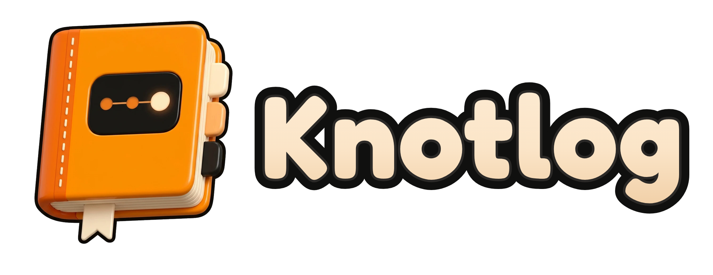
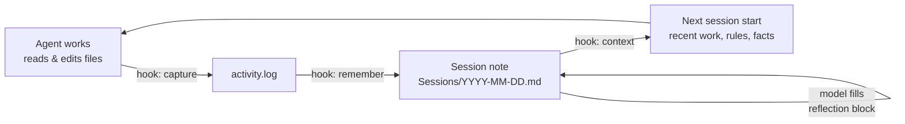

<p align="center">
  
</p>

<p align="center">
  <a href="README.md">English</a> · <a href="README.tr.md">Türkçe</a> · <b>简体中文</b> · <a href="README.ja.md">日本語</a> · <a href="README.es.md">Español</a> · <a href="README.pt-BR.md">Português</a>
</p>

<h3 align="center">为你的编码智能体提供持久记忆</h3>

<p align="center">
  <b>关闭会话，重启电脑，再问一句"我们昨天做了什么？"——你的昨天就回来了。</b>
</p>

<p align="center">
  
</p>

<p align="center">
  <i>本文是 README.md 的中文翻译，以英文版为准。</i>
</p>

<p align="center">
  <a href="https://github.com/MSelmanSonmez/Knotlog/actions/workflows/ci.yml"></a>
  <a href="https://github.com/MSelmanSonmez/Knotlog/releases"></a>
  <a href="LICENSE"></a>
  
  
</p>

<p align="center">
  <a href="#快速开始">快速开始</a> ·
  <a href="#工作原理">工作原理</a> ·
  <a href="#支持的智能体">支持的智能体</a> ·
  <a href="#常见问题">常见问题</a> ·
  <a href="#文档">文档</a>
</p>

```bash
curl -fsSL https://raw.githubusercontent.com/MSelmanSonmez/Knotlog/main/install.sh | sh
```

Knotlog 为 Claude Code、Codex 等编码智能体提供比会话更长久的记忆。记忆以纯 Markdown 形式保存在你自己的文件夹（即*保险库*，vault）中，每次会话开始时注入相关部分，并且不会把任何内容发出你的机器。它是一个 POSIX shell 脚本：无需 Python、Node、数据库或 API 密钥。

> **前身为 Quipu。** Knotlog 是 Quipu 的新名称；旧的 `quipu` 命令已移除。如果你有用旧名称创建的保险库，运行 `knotlog migrate` 预览变更，运行 `knotlog migrate --apply` 写入变更；它也会把旧的 `quipu` 钩子命令改写为 `knotlog`。手工编辑过的桥接块不会被刷新（只重命名其标记），并会给出警告。

## 失忆测试

这是 Knotlog 价值最简短的证明，你可以自己试一试：

1. 和你的智能体做一些真正的工作——做决定、写笔记、收尾一个话题。
2. 关闭会话，重启电脑。
3. 打开新会话，只问一个问题：*"我们昨天做了什么？"*

没有 Knotlog，回答是*"我无法访问之前的对话。"*
有了 Knotlog，回答就是你的昨天：做过的决定、决定的理由，以及停在了哪里——这些是从保险库读回来的，而不是来自模型的记忆。

## 快速开始

**macOS / Linux——一行命令，无需克隆：**

```bash
curl -fsSL https://raw.githubusercontent.com/MSelmanSonmez/Knotlog/main/install.sh | sh
```

**Windows（PowerShell，从源码安装）：**

```powershell
git clone https://github.com/MSelmanSonmez/Knotlog.git; cd Knotlog
.\install.ps1
```

**macOS / Linux / Git Bash（从源码安装）：**

```bash
git clone https://github.com/MSelmanSonmez/Knotlog.git && cd Knotlog
./knotlog install
```

安装程序会问四件事——语言、保险库位置、你的名字，以及可选的伙伴（companion）名称和保险库用途——然后创建保险库，为 Claude Code 和 omp 接好线，并以唯一的下一步结束：打开保险库文件夹，运行 `knotlog doctor`。新用户只需要做这些。

接着阅读用户指南——[docs/GUIDE.zh-CN.md](docs/GUIDE.zh-CN.md)（[English](docs/GUIDE.md) · [Türkçe](docs/GUIDE.tr.md)）——了解日常使用流程和需要手动输入的命令。还不确定它是否适合你？[docs/WHY.zh-CN.md](docs/WHY.zh-CN.md)（[English](docs/WHY.md) · [Türkçe](docs/WHY.tr.md)）一篇文章讲清楚。

## 工作原理



Hook 记录智能体碰过哪些文件，`remember` 把这份记录变成带日期的会话笔记，模型则在笔记内的反思块中写下*原因*。下一次会话开始时，`context` 会在固定的字节预算内注入最近的会话、未完成的话题、你的规则和你的事实，让智能体从你离开的地方继续。Knotlog 负责机械记录；语义则来自本来就在运行的模型。

## 支持的智能体

| 智能体 | Knotlog 的接入方式 | 状态 |
|---|---|---|
| **Claude Code** | 项目级 hook，由 `install` 接入 | 已在真实会话中验证 |
| **Codex** | `adapters/codex/hooks.json`，需手动复制；只需确认一次信任提示 | 已在 CLI 0.153.0（Linux）上实测验证 |
| **omp** (oh-my-pi) | `session_start` hook，由 `install` 接入 | 已实测验证一次 |
| **Antigravity** | `knotlog setup antigravity` 写入 `.agents/hooks.json`（会话开始时的上下文，回合结束时的保存守卫） | 已有测试覆盖；尚未实测验证 |
| **Windsurf / Devin Desktop** | `knotlog setup windsurf` 写入 `.devin/hooks.json`（记录编辑，每次响应后 remember；上下文经由 `AGENTS.md`） | 已在 Linux 上实测验证（Devin Desktop 3.11.216）；Windows 未验证 |
| **OpenCode** | `knotlog setup opencode` 写入 `.opencode/plugins/knotlog.js`（记录编辑，空闲时 remember；上下文经由 `AGENTS.md`） | 已在 Linux 上实测验证（OpenCode 1.19.4）；Windows 未验证 |
| **其他任何智能体**（Cursor 等） | `knotlog context --bridge` 把记忆写入 `AGENTS.md` 和 `CLAUDE.md` | 无需 hook |

Claude Code 读取 `CLAUDE.md`，其他大多数智能体读取 `AGENTS.md`；Knotlog 把同一份记忆写入两者，因此在一个智能体中完成的工作也能传到另一个。各适配器的详情见 [docs/REFERENCE.md](docs/REFERENCE.md#claude-code)。

## 为什么选择 Knotlog

- **零依赖**：仅需 POSIX sh + sed + awk + grep + tr + git（无需 Python、Node、jq）。
- **100% 离线**、**免费**：没有任何内容离开你的机器，无需 API 密钥，零 token 成本。
- **跨平台**：Windows、macOS、Linux——三者均经 CI 验证。
- **多语言**：界面提供六种语言（English、Türkçe、Español、Português (Brasil)、日本語、简体中文）。可用 `--lang <代码>`（`en`、`tr`、`es`、`pt-br`、`ja`、`zh-cn`）、配置中的 `lang=` 或安装向导选择。英语和土耳其语由人工维护，其余翻译为机器辅助，欢迎提出修正。
- **存储**：纯 Markdown，无数据库——文件归你所有，无厂商锁定。
- **默认开启的密钥关卡**：保险库是一个 git 仓库，带有 pre-commit 扫描器，会拒绝包含已知密钥形态的提交。
- **不只是笔记，更是行为契约**：`Rules.md` 和 `Facts.md` 在每次会话开始时注入——你写下一次的纠正会在下一次会话中继续生效，而不必反复重复。

为什么竞品要为基础设施收费而这里免费：像 claude-mem 这样的工具需要单独的向量数据库和 AI worker，因为它们的 worker 是内部没有模型的独立进程。Knotlog 没有这个问题——智能体本来就在运行且已付费，所以语义层*就是*模型本身。

## 命令

这里是你实际会输入的命令；完整表格见 [docs/REFERENCE.md](docs/REFERENCE.md#commands)。

| 命令 | 作用 |
|---|---|
| `knotlog doctor` | 检查设置：工具、智能体、失效链接、未提交的记忆 |
| `knotlog search <terms>` | 查找笔记（BM25，忽略重音符号；支持 `--tag`/`--status` 过滤） |
| `knotlog note "<text>"` | 向今天会话的反思中添加一行 |
| `knotlog context` | 打印智能体在会话开始时看到的内容 |
| `knotlog tui` | 在终端中浏览最新的会话笔记 |
| `knotlog plan <name> --proje <Project>` | 在项目内打开一份计划笔记 |
| `knotlog help [--<代码>]` | 显示英文帮助，加 `--<代码>` 显示其他随附语言的帮助（例如 `--tr`） |

## 第一次会话

完整走一遍第一次会话：

```
$ knotlog init
knotlog vault initialized: <vault>
layout: emoji
AGENTS.md bridge block ensured
companion.md seeded
Rules.md seeded
Facts.md seeded
next: knotlog index
Secret gate not installed: the vault is not a git repository root — run git init, then knotlog init again
$ printf '# Work note\n\nAbout Istanbul.\n' > note.md
$ knotlog index
# indexed 6 (reused 0, stale 6, dropped 0)
$ knotlog search work --paths
Rules.md
Facts.md
🔮 850-Companion/companion.md
note.md
$ knotlog context --json SessionStart
{"hookSpecificOutput":{"hookEventName":"SessionStart","additionalContext":"…"}}
$ knotlog doctor; echo $?
summary: 139 ok, 3 warn, 0 fail
0
```

预置的 `Rules.md`、`Facts.md` 和 `companion.md` 都是普通笔记，会和其他笔记一样被索引，所以范围宽泛的查询会把它们和你自己的笔记一起返回——请缩小搜索词，或用 `--tag`/`--status` 过滤。密钥关卡那一行是 `init` 打印的最后一行：当保险库是 git 仓库根目录时，它会安装 `.githooks/pre-commit`；不是时则会如此提示。

给 `init` 传入 `--lang <代码>`（例如 `--lang tr`）可改为其他语言输出。

## 常见问题

<details>
<summary><b>有内容会离开我的机器吗？</b></summary>

不会。Knotlog 只读写你保险库中的文件，不运行任何服务器。唯一会访问网络的命令是安装程序和 `knotlog update`，它们与 GitHub 通信。Knotlog 注入会话的内容之后会和该会话中的其他内容一样发送给你的智能体的模型提供方——这部分由你的提供方的数据政策决定。
</details>

<details>
<summary><b>它会覆盖我的 CLAUDE.md、AGENTS.md 或 Claude 设置吗？</b></summary>

不会。Knotlog 只在自己的标记块（`<!-- knotlog:start -->` … `<!-- knotlog:end -->`）内写入；标记块之外的一切都归你所有，绝不会被触碰。如果你的 `.claude/settings.json` 已与 Knotlog 的适配器不同，install 会逐字节保留你的文件，并告诉你需要合并什么。
</details>

<details>
<summary><b>哪些智能体效果最好？</b></summary>

Claude Code：其适配器已在真实会话中验证，`install` 会替你接好。Codex 在你复制一个文件并确认一次信任提示后即可工作。其他任何智能体都可以使用无 hook 的桥接方式，任何 MCP 客户端都可以通过 `knotlog mcp`（工具 `knotlog_search`、`knotlog_context` 和 `knotlog_note`）搜索保险库。参见[支持的智能体](#支持的智能体)。
</details>

<details>
<summary><b>它能在 Windows 上使用吗？</b></summary>

可以。在 PowerShell 中用 `.\install.ps1` 安装；需要 Git for Windows，不需要管理员权限。测试套件在 CI 中于 Windows、macOS 和 Linux 上运行，并且已在 Windows 和 Linux 上完成真实的端到端安装。macOS 目前仅经 CI 验证。
</details>

<details>
<summary><b>如何卸载？</b></summary>

`knotlog uninstall --dry-run` 会显示将被移除的内容，`knotlog uninstall` 移除该命令（Windows 上用 `.\uninstall.ps1`）。你的保险库绝不会被删除——那是你的笔记。参见 [Uninstall](docs/REFERENCE.md#uninstall)。
</details>

<details>
<summary><b>这与向量数据库式的记忆有何不同？</b></summary>

这里没有嵌入（embedding）步骤，也没有第二个模型。Knotlog 做快速的词法搜索（对忽略重音的文本做 BM25），把判断交给已经在循环中的智能体。这在语义理解上更好，但在穷尽式召回上较弱——见下文的局限。
</details>

## 坦率的局限

- **折叠（folding）是有损的**：`açık` 和 `acık` 会被合并——这是有意的取舍。
- **"语义"不等于余弦相似度**：这是模型的判断，语义上更好，但穷尽式召回较弱。
- **索引上下文上限**：几千条笔记以内都很从容；超过后请先用 `search --brief` 缩小范围。
- **macOS 经 CI 验证，尚未实机安装**；如果那里有异常，欢迎提交报告。

完整列表（包括每个适配器*不会*捕获的内容）见 [docs/REFERENCE.md](docs/REFERENCE.md#honest-limits)。

## 文档

- [用户指南](docs/GUIDE.zh-CN.md)（[English](docs/GUIDE.md) · [Türkçe](docs/GUIDE.tr.md)）——日常流程、各文件夹、需要手动输入的命令。
- [为什么选择 Knotlog](docs/WHY.zh-CN.md)（[English](docs/WHY.md) · [Türkçe](docs/WHY.tr.md)）——一篇文章讲清楚理由。
- [参考手册](docs/REFERENCE.md)——安装内部机制、所有命令、各适配器、保险库布局、搜索、更新与回滚。
- [使用手册](docs/USAGE.md)——写给编码智能体照做的分步设置说明；由测试锁定，因此不会与真实命令偏离。

## 许可证

MIT——见 [LICENSE](LICENSE)。
